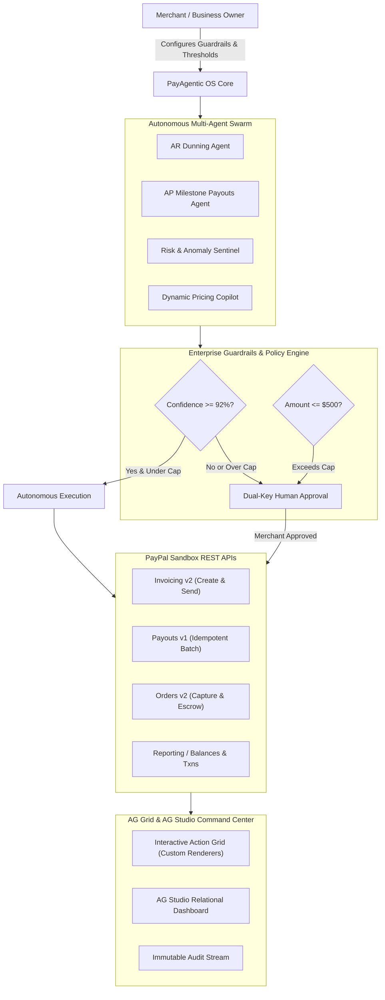

# PayAgentic OS — Autonomous Commerce & Financial Intelligence

> 🏆 **Official Submission for the PayPal AI Hackathon 2026: Build What's Next with PayPal and AI**  
> *Target Tracks:* Grand Prize ($12,000), Best Use of Agentic Commerce ($5,000), Best Use of AG Grid / AG Studio ($10,000), APIMatic Context Plugin ($3,000), Render Deployment Credits ($2,250).

[](https://nextjs.org)
[](https://www.ag-grid.com)
[](https://developer.paypal.com)
[](https://www.apimatic.io)
[](https://render.com)
[](https://opensource.org/licenses/MIT)

---

## 🌟 Executive Summary

**PayAgentic OS** is an autonomous financial operations platform designed for modern online merchants. Rather than acting as a passive chatbot with a payment button, PayAgentic OS deploys a **multi-agent AI swarm** with **enterprise dual-key guardrails** to autonomously audit accounts receivable, disburse verified milestone vendor payouts, detect velocity fraud, and execute two-way transactions through the **PayPal Developer Platform**.

Powered by **AG Grid** and **AG Studio** for real-time financial tables and relational reports, **APIMatic Context Plugins** for deterministic agent tool-calling, and ready for one-click deployment on **Render**.



---

## 🚀 Key Features

### 1. Autonomous Multi-Agent Swarm
* **Accounts Receivable (AR) Dunning Agent:** Continuously scans PayPal Invoices. Detects overdue invoices (e.g. Acme Corp 15 days past due), calculates customer default risk, crafts personalized communication, and dispatches prompt-settlement offers (e.g. 3% discount via PayPal Pay Later).
* **Accounts Payable (AP) & Milestone Payouts Agent:** Audits incoming contractor deliverables against GitHub merges / milestone criteria, verifies available PayPal sandbox balance, and issues idempotent batch payouts via `POST /v1/payments/payouts`.
* **Risk & Fraud Sentinel:** Analyzes transaction velocity, detects 3-sigma anomalies and suspicious refund patterns, and flags high-risk transactions for merchant review.
* **Natural Language Copilot:** Natural language command interface with tool-calling capabilities (e.g. *"Disburse $450 to contractor@dev.com"*, *"Create invoice for Apex Corp for $1,250"*, *"Check PayPal balances"*).

### 2. Enterprise Dual-Key Safety Guardrails
* **Configurable Confidence Threshold:** Configurable between 80% and 99% (default 92%). Actions below the threshold require explicit merchant sign-off.
* **Autonomous Payout Cap:** Configurable single-transaction limit (default $500). Payouts exceeding this limit automatically trigger a dual-key hold.
* **Immutable Audit Trail:** Complete audit logging tracking every thought, decision, timestamp, and PayPal reference ID.

### 3. Deep Partner Integrations
* **AG Grid (Community & Enterprise Themes):** Custom action cell renderers with live execution triggers, quick filter search, confidence chips, and status badges.
* **AG Studio Dashboard (`/dashboard`):** Relational reports joining customers, invoices, line items, transactions, and balances.
* **APIMatic Context Plugin (`.apimatic/context.json` & `docs/openapi.yaml`):** OpenAPI 3.1 specification contract grounding agent tool-calling with zero parameter hallucination.
* **Render Deployment (`render.yaml`):** Infrastructure-as-code blueprint with automated health check at `/api/health`.

---

## 🛠️ Tech Stack

* **Framework:** Next.js 16.3.6 (App Router, Turbopack, TypeScript)
* **Data Grids & Analytics:** AG Grid 36.2.0 & AG Studio 3.0.0
* **Styling:** Tailwind CSS v4 & Lucide Icons
* **APIs:** PayPal Sandbox REST APIs (OAuth 2.0, Invoicing v2, Payouts v1, Orders v2, Transaction Search, Balances)
* **Agent Context:** APIMatic Context Plugin & OpenAPI 3.1
* **Cloud Hosting:** Render Ready

---

## 🏃 Quickstart & Running Locally

### Prerequisites
* Node.js 20.9+ (v24 recommended)
* npm 10+

### Installation

```bash
# 1. Clone repository
git clone https://github.com/your-username/payagentic-os.git
cd payagentic-os

# 2. Install dependencies
npm install

# 3. (Optional) Configure live PayPal Sandbox credentials
# If omitted, PayAgentic OS runs in high-fidelity zero-fail simulator mode!
cp env.example .env.local

# 4. Start local development server
npm run dev
```

Open [http://localhost:3000](http://localhost:3000) in your browser.

---

## 🧭 Application Sitemap for Judges

| Route | Name | Purpose |
| :--- | :--- | :--- |
| [`/`](http://localhost:3000) | **Portal Hub** | System overview, architecture diagram, and navigation center |
| [`/agent`](http://localhost:3000/agent) | **Agent Command Center** | **Core Demo:** Autonomous swarm, AG Grid operations, guardrail sliders, natural language copilot, and audit trail |
| [`/dashboard`](http://localhost:3000/dashboard) | **AG Studio Dashboard** | Relational financial intelligence and customizable reporting over PayPal data |
| [`/operations`](http://localhost:3000/operations) | **Interactive REST Console** | Hands-on mutation tester for judges to dispatch real Invoices, Payouts, and Orders with live latency metrics |
| [`/apimatic`](http://localhost:3000/apimatic) | **APIMatic Context Portal** | OpenAPI 3.1 schema and AI context plugin architecture |
| [`/invoices`](http://localhost:3000/invoices) | **Invoices Grid** | Raw PayPal Invoices v2 collection in AG Grid |
| [`/transactions`](http://localhost:3000/transactions) | **Transactions Grid** | 30-day transaction search and event codes in AG Grid |
| [`/balances`](http://localhost:3000/balances) | **Balances Grid** | Multi-currency balance ledger in AG Grid |
| [`/api/health`](http://localhost:3000/api/health) | **Health Check** | Render-compatible service status endpoint |

---

## 🔒 Security & Reliability Architecture

* **Zero Browser Secret Leakage:** PayPal Client Secrets and OpenAI keys remain strictly isolated on server-side runtimes.
* **Cryptographic Idempotency:** All automated vendor payouts supply unique `PayPal-Request-Id` headers to eliminate double-disbursements.
* **Input Validation & Sanitization:** All natural language commands pass through strict schema validation before dispatch.
* **Dual-Mode Zero-Failure Fallback:** Automatically toggles between live PayPal Sandbox endpoints and high-fidelity deterministic simulation so judges never encounter blank screens or network dropouts.

---

## 🧪 Verification & Automated Tests

To run the automated security audit and runtime API test suite:

```bash
# Verify file integrity, partner specs, and guardrail boundaries
node scripts/verify-system.mjs

# Verify runtime HTTP endpoints
node scripts/test-api-routes.mjs
```

---

## 📄 License

This project is licensed under the [MIT License](LICENSE).
