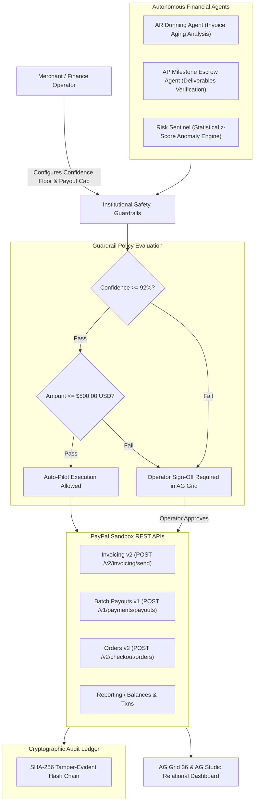

# PayAgentic OS — Autonomous AI AR/AP & Risk Copilot for PayPal Sandbox

> 🏆 **Submission for the PayPal AI Hackathon 2026: Build What's Next with PayPal and AI**  
> *Target Tracks:* Main Hackathon Tracks · Best Use of AG Grid & AG Studio · Best Use of APIMatic Context Plugin · Best Use of Render  
> 🌐 **Live Demo Application:** [https://payagentic-os.vercel.app](https://payagentic-os.vercel.app) · [Agent Command Center](https://payagentic-os.vercel.app/agent) · [Pitch Video (1080p)](https://payagentic-os.vercel.app/demo-video.mp4)

[](https://nextjs.org)
[](https://www.ag-grid.com)
[](https://developer.paypal.com)
[](https://www.apimatic.io)
[](https://render.com)
[](https://opensource.org/licenses/MIT)

---

## 🌟 Overview

**PayAgentic OS** is an autonomous financial operations copilot designed for merchants operating on the PayPal Developer Platform. Rather than a generic chatbot that redirects users to an external checkout link, PayAgentic OS deploys **three specialized financial subagents** bounded by **institutional safety guardrails** to:
1. Proactively manage accounts receivable (AR) and overdue invoice dunning with prompt settlement discounts.
2. Automate verified vendor and contractor milestone disbursements (AP) using batch payouts and mandatory idempotency keys.
3. Detect statistical transaction volume anomalies using mathematical $z$-score analysis and temporarily hold suspicious settlements in escrow.

All agent operations are displayed in an **AG Grid** command center, backed by an **AG Studio** relational intelligence dashboard, grounded in an **APIMatic Context Plugin & OpenAPI 3.1** specification, and tracked with a **cryptographically hash-chained audit ledger**.



---

## 🚀 Key Technical Highlights

### 1. Dual-Engine Agent Swarm (Cloud Neural + Local Deterministic)
* **Mode A (Cloud Neural LLM):** When `OPENAI_API_KEY` is provided, the copilot leverages `gpt-4o-mini` with function calling schemas dynamically loaded from the **APIMatic Context Plugin** (`.apimatic/context.json`).
* **Mode B (Deterministic Financial Logic):** Runs completely offline with zero external dependencies using mathematical intent parsing and invoice aging models so judges can test the full workflow without providing an OpenAI key.

### 2. Real Statistical Anomaly Detection (Risk Sentinel)
* Instead of arbitrary static flags, the Risk Sentinel computes the arithmetic mean $\mu = \frac{1}{N}\sum x_i$ and sample standard deviation $\sigma = \sqrt{\frac{1}{N-1}\sum (x_i - \mu)^2}$ across all transactions in the 30-day window.
* Anomaly flags are mathematically triggered when a transaction deviates by $z \ge 2.0\sigma$, with the exact $z$-score and dollar deviation presented in the explainable reasoning.

### 3. Institutional Safety Guardrails
* **Confidence Floor:** Configurable between 80% and 99% (default 92%). Recommendations scoring below the threshold are held for human sign-off.
* **Autonomous Payout Cap:** Configurable per-transaction ceiling (default $500.00 USD). Any disbursement request over this limit automatically triggers an approval hold.
* **Cryptographic Idempotency:** Every payout and invoice operation carries an explicit `PayPal-Request-Id` (e.g. `IDEMP-COPILOT-...`) preventing accidental double disbursements on network retries.

### 4. Cryptographically Hash-Chained Audit Ledger
* Every action evaluation, auto-pilot execution, merchant approval, and rejection is recorded into a tamper-evident audit ledger.
* Each entry computes `hash = SHA256(index + timestamp + actionId + event + prevHash + details)` linked directly to the previous block's hash. A built-in verification suite tests and validates the integrity of the chain.

---

## 🛠️ Sponsor Tool Integrations

* **PayPal Developer Platform (Sandbox):**
  * Invoicing v2 (`/v2/invoicing/invoices`, `/v2/invoicing/invoices/{id}/send`) with prompt discount settlement terms.
  * Batch Payouts v1 (`/v1/payments/payouts`) with idempotency headers.
  * Orders v2 (`/v2/checkout/orders`) for escrow risk holds.
  * Reporting Balances (`/v1/reporting/balances`) and Transaction Search.
  * Webhook listener (`/api/paypal/webhook`) with HMAC simulation.

* **AG Grid 36 & AG Studio 3:**
  * Interactive Action Grid (`app/agent/components/agent-actions-grid.tsx`) with custom action renderers (Approve / Reject buttons, status chips, confidence indicators).
  * 5-collection relational BI model (`lib/dashboard-data.ts`) connecting customers, invoices, transactions, line items, and balances.

* **APIMatic Context Plugin:**
  * `.apimatic/context.json` and `docs/openapi.yaml` provide the OpenAPI 3.1 contract.
  * `lib/ai.ts` directly imports and parses `.apimatic/context.json` to ground LLM tool definitions, eliminating parameter hallucinations.

* **Render Deployment Blueprint:**
  * `render.yaml` specifies an Infrastructure-as-Code web service with automated health monitoring at `/api/health`.

---

## 🧪 Testing & Verification

Run the comprehensive unit test suite covering statistical calculations, cryptographic hash chaining, and policy bounds:

```bash
node scripts/verify-system.mjs
```

Run the end-to-end HTTP route and guardrail validation suite:

```bash
npm run build
node scripts/test-api-routes.mjs
```

---

## 🏃 Local Setup

```bash
# 1. Clone repository
git clone https://github.com/AbayAtazhan/payagentic-os.git
cd payagentic-os

# 2. Install dependencies
npm install

# 3. Configure environment variables (optional; defaults to high-fidelity Sandbox simulation)
cp env.example .env.local

# 4. Start development server
npm run dev
```

Visit [http://localhost:3000/agent](http://localhost:3000/agent) to explore the Agent Command Center.

---

## 📄 License

MIT Licensed — See [LICENSE](LICENSE) for details.
